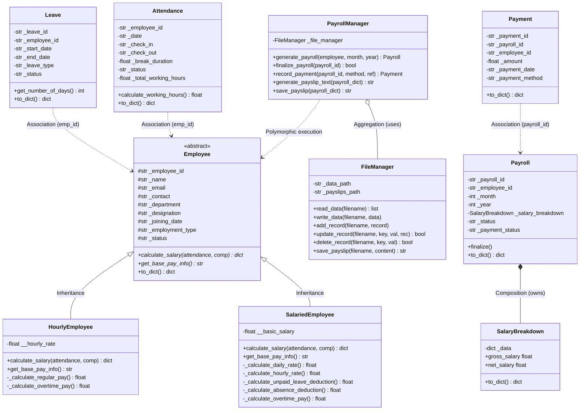
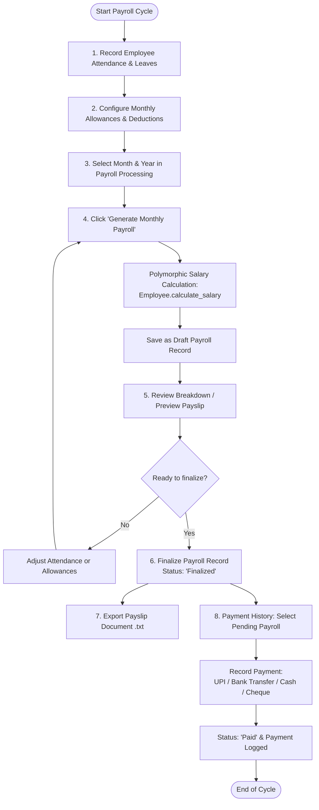

# Payroll & Compensation Management System
**Academic Semester Project: Object-Oriented Programming (Python)**

A desktop-based Payroll & Compensation Management System built with **Python 3**, **Tkinter**, and **JSON File Persistence**.

> [!NOTE]
> **Academic Project Disclaimer:**  
> This project is designed for undergraduate OOP curriculum evaluation and project viva presentation. The salary calculation models, overtime formulas, and leave deductions are simplified academic representations and do not claim to comply with official statutory regulations (e.g., Indian statutory payroll/PF/ESI laws).

---

## 1. Project Introduction & Objectives

In any enterprise, payroll management is a vital operational task requiring accurate calculation of employee salaries, work hours, overtime, leave deductions, and bonuses. 

The objective of this project is to develop a complete, beginner-friendly desktop application that solves real-world payroll requirements while clearly demonstrating practical **Object-Oriented Programming (OOP)** principles:
- Maintaining persistent employee, attendance, leave, compensation, and payment records.
- Automatically calculating gross and net salaries using attendance data.
- Generating formatted payslips (both in-app preview and `.txt` file export).
- Tracking pending disbursements and recording completed transactions.
- Presenting a clean, intuitive desktop user interface built with standard `tkinter` and `ttk`.

---

## 2. Technologies Used

- **Programming Language:** Python 3 (Standard Library only)
- **GUI Framework:** `tkinter` & `ttk` (Standard Python GUI)
- **Data Storage:** JSON Files (`json` module) - No SQL or heavy databases required
- **Unit Testing Framework:** `unittest`
- **Utilities:** `datetime`, `os`, `abc`

---

## 3. Project Directory Structure

```text
Payroll_Management_System/
│
├── main.py                  # Application entry point; initializes sample data & launches GUI
├── employee.py              # Employee base class, SalariedEmployee, and HourlyEmployee
├── records.py               # Attendance, Leave, and Payment domain entities
├── payroll.py               # Payroll, SalaryBreakdown (composition), and PayrollManager
├── file_manager.py          # FileManager class for robust JSON CRUD operations
├── gui.py                   # Tkinter desktop GUI (8 operational tabs)
│
├── data/                    # JSON persistent data storage
│   ├── employees.json       # Employee directory
│   ├── attendance.json      # Daily check-in/out and status records
│   ├── leaves.json          # Leave applications & approval status
│   ├── compensation.json    # Allowances, bonuses, and deductions
│   ├── payroll.json         # Finalized & draft monthly payroll records
│   └── payments.json        # Disbursement transaction history
│
├── payslips/                # Exported text payslip documents (.txt)
│
├── tests/
│   └── test_payroll.py      # 30 comprehensive automated unit tests
│
└── README.md                # Academic project documentation & viva guide
```

---

## 4. Key OOP Concepts Implemented

This project was built to clearly exhibit core OOP principles without unnecessary, convoluted abstractions.

| OOP Concept | Where It Is Used | Academic Explanation |
| :--- | :--- | :--- |
| **Classes & Objects** | `Employee`, `SalariedEmployee`, `HourlyEmployee`, `Attendance`, `Leave`, `Payment`, `Payroll`, `SalaryBreakdown`, `PayrollManager`, `FileManager` | Every real-world entity and system responsibility is modeled as an independent class. Objects are instantiated and interact cleanly. |
| **Encapsulation** | All classes (e.g., `_employee_id`, `__basic_salary`, `_date`) | Data attributes are kept private/protected. Controlled access, getter/setter properties, and input validations prevent invalid states. |
| **Abstraction** | `Employee` (inherits from `abc.ABC`) | `Employee` defines abstract methods `calculate_salary()` and `get_base_pay_info()`. The base class cannot be instantiated directly, defining a clear contract. |
| **Inheritance** | `SalariedEmployee(Employee)` and `HourlyEmployee(Employee)` | Common employee attributes (`name`, `department`, `designation`) are inherited from `Employee`, while subclass-specific attributes are added. |
| **Polymorphism (Method Overriding)** | `employee.calculate_salary(attendance_summary, compensation)` | Both subclasses override `calculate_salary()`. When `PayrollManager` iterates through active employees, it invokes `calculate_salary()` uniformly without checking employee type. |
| **Constructors & `super()`** | `__init__()` methods | Subclasses invoke the base class constructor via `super().__init__(...)` before initializing their own attributes (`basic_salary` or `hourly_rate`). |
| **Composition** | `Payroll` owns `SalaryBreakdown` | A `SalaryBreakdown` object is created inside `Payroll`. If the payroll record is deleted, its breakdown is also deleted. |
| **Aggregation** | `PayrollManager` uses `FileManager` and `Employee` | `PayrollManager` holds references to `FileManager` and interacts with `Employee` objects, but does not own them (they exist independently). |
| **Association** | `Attendance`, `Leave`, and `Payment` link to `Employee` via `employee_id` | Loose coupling where records refer to employees by their identifier. |
| **Exception Handling** | Custom hierarchy: `EmployeeError`, `InvalidSalaryError`, `DuplicatePayrollError`, `PayrollNotFinalizedError` | Prevents crashes and delivers clean, understandable error messages in GUI dialogs. |
| **File Persistence** | `FileManager` | Encapsulates JSON file I/O operations away from UI and domain calculations. |

---

## 5. UML Diagrams

### A. Class Relationship Diagram



### B. Payroll Processing & Disbursement Workflow



---

## 6. Salary Calculation Formulas

### A. Salaried Employees
- **Standard Working Days per Month:** 22
- **Standard Working Hours per Day:** 8
- **Daily Rate:** $\text{Daily Rate} = \frac{\text{Basic Salary}}{22}$
- **Hourly Rate:** $\text{Hourly Rate} = \frac{\text{Basic Salary}}{22 \times 8}$
- **Unpaid Leave Deduction:** $\text{Unpaid Leave Days} \times \text{Daily Rate}$
- **Absence Deduction:** $(\text{Absent Days} \times \text{Daily Rate}) + (\text{Half Days} \times 0.5 \times \text{Daily Rate})$
- **Overtime Pay:** $\text{Approved OT Hours} \times \text{Hourly Rate} \times 1.5$
- **Gross Salary:** $\text{Basic Salary} + \text{Allowances} (\text{HRA} + \text{Transport} + \text{Medical} + \text{Other}) + \text{Bonus} + \text{Overtime Pay}$
- **Total Deductions:** $\text{Unpaid Leave Deduction} + \text{Absence Deduction} + \text{Other Deductions}$
- **Net Salary:** $\text{Gross Salary} - \text{Total Deductions}$

*(Note: Paid leaves do not deduct from salary).*

### B. Hourly Employees
- **Regular Hours:** $\text{Total Working Hours} - \text{Overtime Hours}$
- **Regular Pay:** $\text{Regular Hours} \times \text{Hourly Rate}$
- **Overtime Pay:** $\text{Overtime Hours} \times \text{Hourly Rate} \times 1.5$
- **Gross Salary:** $\text{Regular Pay} + \text{Overtime Pay} + \text{Total Allowances} + \text{Bonus}$
- **Net Salary:** $\text{Gross Salary} - \text{Other Deductions}$

*(Hourly employees do not receive absence deductions because they are compensated strictly for hours clocked).*

---

## 7. Sample Demonstration Data

On the first application run, sample records for **October 2026 (22 working days)** are loaded automatically:

1. **`EMP001` - Rahul Sharma (Salaried, Rs. 50,000/mo):**
   - Full attendance across 22 working days.
   - 2 days with 2 hours overtime each (total 4 OT hours).
   - HRA: Rs. 5,000, Transport: Rs. 2,000, Medical: Rs. 1,500.
2. **`EMP002` - Priya Patel (Salaried, Rs. 60,000/mo):**
   - 18 present days, 2 paid leaves, 1 unpaid leave, 1 absent day.
   - Demonstrates unpaid leave deduction and absence deduction.
   - HRA: Rs. 8,000, Transport: Rs. 3,000, Medical: Rs. 2,000, Bonus: Rs. 5,000.
3. **`EMP003` - Amit Kumar (Hourly, Rs. 300/hr):**
   - Clocked 20 days (with 5 days having 2 hours overtime = 10 OT hours).
   - 2 absent days. Transport allowance: Rs. 1,500.
4. **`EMP004` - Neha Singh (Hourly, Rs. 250/hr):**
   - Clocked 17 regular days, 2 half-days (4 hours each), 2 holidays, 1 absent day.
   - Transport allowance: Rs. 1,000, Other deductions: Rs. 500.

---

## 8. How to Run the Application

### Prerequisites
- Python 3.8 or higher installed on your system.

### Starting the GUI
Open a terminal / PowerShell prompt in the project root folder and run:
```bash
python main.py
```

### Running Automated Unit Tests
To run all 30 automated unit tests:
```bash
python -m unittest tests/test_payroll.py -v
```

---

## 9. Viva / Presentation Walkthrough Guide

When demonstrating the project during your evaluation or viva, follow these steps:

1. **Start Application (`python main.py`):**
   - Show the **Dashboard** displaying current active employees (4 sample employees) and pending metrics.
2. **Explain Class Structure (`employee.py`):**
   - Point out `Employee` as the abstract base class and explain how `SalariedEmployee` and `HourlyEmployee` inherit from it and use `super().__init__()`.
3. **Show Polymorphism in Action (`payroll.py`):**
   - Open the **Payroll Processing** tab.
   - Select Month: `10`, Year: `2026`.
   - Click **Generate Monthly Payroll**.
   - Explain to the examiner that `PayrollManager.generate_payroll()` calls `employee.calculate_salary()` identically for all employees, and Python automatically executes the correct formula at runtime based on the object's class.
4. **Inspect Salary Breakdown:**
   - Select `EMP002` (Priya Patel) and click **View Detailed Breakdown**.
   - Explain how 1 unpaid leave and 1 absent day produced deductions from her basic salary.
   - Select `EMP001` (Rahul Sharma) and show how overtime hours and allowances were calculated.
5. **Demonstrate Finalization & State Preservation:**
   - Click **Finalize Selected**.
   - Mention that once finalized, the payroll record is locked and cannot be altered, preserving historical payroll records even if employee basic salary changes in the future.
6. **Generate Payslip:**
   - Switch to the **Payslips** tab.
   - Select `EMP001` (Month 10 / Year 2026) and click **Preview Payslip**.
   - Click **Save to .txt File** and open the generated file inside the `payslips/` folder.
7. **Simulate Payment Disbursement:**
   - Go to the **Payment History** tab.
   - The finalized payroll now appears under **Pending Payments**.
   - Select the payment method (e.g., **UPI** or **Bank Transfer**), enter a transaction reference, and click **Record Payment**.
   - The item moves to **Disbursement History**, and the payroll status updates to `Paid`.
8. **Show Persistence & Integrity:**
   - Close the GUI application.
   - Reopen `main.py`.
   - Point out that all generated payrolls, payment history, and attendance records persist in the `data/` JSON files.
